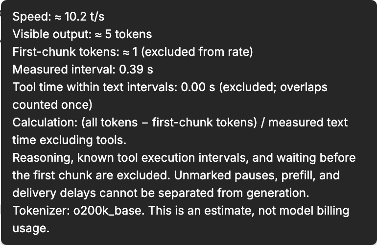

# Token Speed (TPS)

Estimate visible output tokens per second beside BB's native message actions. Reasoning, first-chunk waiting, and known tool execution intervals are excluded.

## Features

- A compact `≈ 42.7 t/s` value alongside existing message actions, using BB's native hover and focus reveal behavior.
- A full breakdown in a tooltip on the adjacent ⓘ marker, available on hover and keyboard focus. Native dropdown and context menus remain unchanged.
- Local `o200k_base` tokenization of complete assistant message text, including Markdown and code.
- Known tool execution time excluded from text intervals; nested and parallel calls are counted only once.
- Snapshot token counts when historical stream events are missing, without inventing a speed.
- Tokenization in a local Web Worker, bounded event pagination, and a recent-thread cache.

## Screenshots

### Message actions

The approximate rate and compact info marker share BB's native message-action reveal.


### Token speed details

Hover or focus ⓘ to see the measurement, excluded intervals, and accuracy limits. Both screenshots show only the plugin controls and English labels, without conversation text.



## Installation

Requires BB **0.46+** and a compatible Plugin SDK **0.6.37** runtime.

```sh
bb plugin install git:https://github.com/nicolay-i/bb-plugin-token-speed.git@v0.1.0
```

BB will ask you to confirm the source before installing third-party code and build the plugin from this repository. The generated inline tokenizer worker is committed so Git installation does not depend on npm lifecycle scripts or development dependencies.

If the separate **Turn TPS** plugin is enabled, it will still show its own full-turn rate. Disable it if you do not want both estimates:

```sh
bb plugin disable turn-tps
```

## How the rate is calculated

```text
rate = (tokens(full text) - tokens(first chunk)) / measured text seconds
```

The first chunk has no measured generation interval, so its tokens are excluded from the numerator. Waiting before the first chunk and after the last chunk is not measured. Explicit reasoning gaps are skipped. Known tool intervals are subtracted from the time between text deltas, using the union of overlapping intervals within the same turn and parent flow.

A tool running between two separate messages never enters either message's denominator. A single chunk, equal timestamps, a missing or inconsistent stream, incomplete tool timing, or text delivered during an active tool call produces an unavailable rate rather than a guessed one.

## Accuracy and limitations

The counter always marks its result as approximate. `o200k_base` may differ from the model's own tokenizer. This is **not billing usage or an exact model decode benchmark**: unmarked pauses, prefill, hidden tool-argument generation, and delivery delays cannot reliably be separated from generation inside the model. Very short replies are especially sensitive to buffering.

Only messages with native action controls receive a counter. Completed-turn activity lines without those controls are left unchanged. All plugin labels and tooltip text are in English.

The current SDK has no dedicated message-footer slot, so the plugin enhances existing message controls through a trusted content script. The info tooltip uses BB's theme colors, stays within the viewport, supports pointer movement into its text, and closes on Escape. BB's timeline markup and row identity format are private contracts and may require adaptation after a BB update.

## Privacy

Processing stays inside the BB client. The plugin does not upload message text, call an external token-counting service, or write metrics to a database. It uses BB's public timeline and event APIs, reads mounted message ranges with pages of at most 100 events, and does not poll hidden threads.

## Development

Node.js **22.18+** is required for tests that execute TypeScript directly. Install the BB CLI before building.

```sh
npm ci
npm test
npm run check
npm run build
bb plugin install .
```

After changing an installed local checkout:

```sh
npm run build
bb plugin reload token-speed
```

Use **`npm run build`**, not a direct `bb plugin build`: the npm script regenerates the inline worker source before BB builds the frontend bundle. `worker-source.generated.ts` is generated and committed for Git installation: BB installs production dependencies with lifecycle scripts disabled, then builds the frontend directly. Regenerate and commit this file whenever worker or metric code changes. Build outputs under `dist/` are ignored and rebuilt by BB.

The 22 tests cover token boundaries, reasoning gaps, tool-duration invariance, parallel and nested calls, missing timing, commentary completion, full-snapshot protection, event pagination, asynchronous UI updates, and worker responsiveness. A real BB experiment with two five-token replies around a 45-second process confirmed that process time did not enter the message text intervals.

The store description is maintained in [PLUGIN_OVERVIEW.md](PLUGIN_OVERVIEW.md). Bundled tokenizer attribution is listed in [THIRD_PARTY_NOTICES.md](THIRD_PARTY_NOTICES.md).
